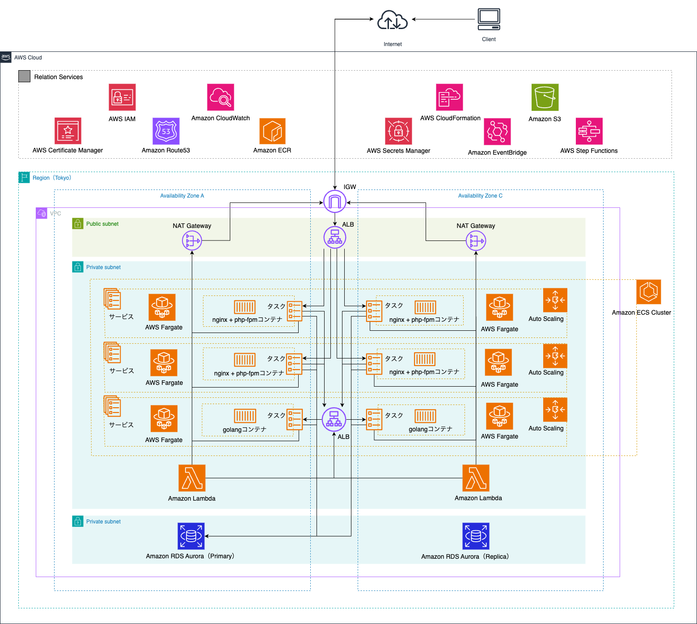

# AppLift

## 🚀 Architecture & Tech Stack

はじめに、本アプリケーションのアーキテクチャと技術スタックをご紹介します。

### Architecture

### Tech Stack

| カテゴリ | 技術 | 目的・担当 |
| :--- | :--- | :--- |
| **Frontend** | **Knockout.js** | メッセージ機能において、画面遷移のないスムーズな操作感を実現するためSPA構成を採用。 |
| **Backend** | **PHP 8.3 / Laravel 11** | アプリケーションの主要機能を提供。メッセージ機能のバックエンドのみGo製APIと連携。 |
| | **Go 1.24** | メッセージ機能のバックエンドAPI。マイクロサービスとして分離し、高いパフォーマンスを実現。 |
| | **Python 3.13** | Step Functionsのワークフロー上で、メッセージ予約送信を実行するトリガーとして機能。指定時刻にGo製APIを呼び出す。 |
| **Database** | **MySQL (Amazon Aurora)** | アプリケーションのメインデータストアとして利用。スケーラビリティと高可用性を確保。 |
| **Infrastructure**| **AWS (ECS, Fargate, ALB, Lambda, Step Functions, EventBridge, S3, RDS, etc.)** | コンテナとサーバーレスを組み合わせたモダンなクラウドネイティブアーキテクチャを構築。詳細は構成図参照。 |
| **DevOps** | **GitHub Actions** | 4つのリポジトリ全てでCI/CDパイプラインを構築。テスト、静的解析、デプロイを自動化。 |
| | **IaC (CloudFormation)** | 再現性のあるインフラ構築と構成管理を実現。リポジトリごとに責務を分割して管理。 |
| | **IaC Static Analysis** | **cfn-lint, cfn-nag** | CloudFormationテンプレートの品質とセキュリティをCIで継続的に担保。 |
| | **Container** | **Docker / Amazon ECR** | アプリケーション環境をコンテナ化し、開発から本番まで一貫した環境を実現。 |

 

---

## 📂 Repository Structure

本アプリケーションは、責務ごとに4つのリポジトリで構成されています。各リポジトリはそれぞれCI/CDパイプラインと、その責務範囲に応じたインフラのコード(IaC)を内包しています。

-   **① Main Application (このリポジトリ)**
    -   Laravelで構築された**メインアプリケーション**です。メッセージ機能のバックエンド処理を除く、UIを含めた全機能を担当します。
-   **② Message API (Go)**
    -   [**リポジトリへのリンク**](https://github.com/yuyacode/AppLiftMessageApi)
    -   メッセージ機能のバックエンド処理を担う**Go製API**です。
-   **③ Message Scheduler**
    -   [**リポジトリへのリンク**](https://github.com/yuyacode/AppLiftMessageScheduler)
    -   **イベント駆動アーキテクチャ**でメッセージの予約送信を実現するシステムです。
-   **④ Common Infrastructure**
    -   [**リポジトリへのリンク**](https://github.com/yuyacode/AppLiftCommonInfra)
    -   全サービスが依存する **共有の基盤インフラ（VPC, ALB, RDS等）** を`CloudFormation`で一元管理しています。

---

## ✨ Key Features & URL

**『知っているけど、応募しない』をなくしたい。**

本アプリケーションは、採用選考が始まる前の「企業」と「未来の候補者」が、本音で繋がるための匿名コミュニケーション・プラットフォームです。

企業の透明性を高め、候補者の不安を解消することで、採用における「認知」と「応募」の間に存在する高いハードルを取り払い、双方にとっての機会損失を防ぐことを目指します。

-   **URL**
    -   企業側：[https://app-lift.com/company/login](https://app-lift.com/company/login)
    -   候補者側：[https://app-lift.com/student/login](https://app-lift.com/student/login)
-   **Test Account**
    -   企業側：`ID: demo_company1@example.com / PW: demo_company1`
    -   候補者側：`ID: demo_student1@example.com / PW: demo_student1`

### 主な機能
-   **企業（社員）向け**：自社レビュー投稿、候補者とのDM機能、プロフィール登録
-   **候補者（学生）向け**：企業レビュー閲覧、社員との匿名DM機能、社員情報閲覧

---

## 💡 Background & Purpose

### 抱えていた課題：採用における最大の障壁

私は現職のHRテック企業で約3年間、採用関連のシステム開発に携わる中で、現在の採用市場が抱える構造的な課題を見つけました。

それが **候補者が企業を『認知』してから『応募』に至るまでのプロセスに存在する非常に高いハードル** です。

-   **候補者側の課題**：SNSなどで企業を知る機会は増えたものの、社内の実情が見えないため「面白そうだけど応募するほどではない」と判断し、自分に合う企業を見逃してしまう。
-   **企業側の課題**：自社にマッチする可能性のある優秀な人材が、興味を持ってくれずに応募に至らず、採用の機会を失ってしまう。

この「すれ違い」は、候補者と企業の双方にとって大きな機会損失です。私は、この課題を解決するサービスが市場にまだ少ないと考え、自ら開発することを決意しました。

### このアプリで実現したかったこと

このアプリケーションを通じて、以下の実現を目指しました。

-   **情報の透明性**：実際に働く社員の「リアルな声（レビュー）」を公開することで、候補者が抱く入社後のイメージとのギャップを埋める。
-   **心理的安全性の確保**：選考に影響しない「匿名でのDM機能」を提供し、候補者がどんな小さな疑問や不安も気軽に質問できる環境を作る。
-   **応募への後押し**：企業のネガティブなイメージや不安を払拭し、「この企業の話を聞いてみたい」という前向きな気持ちを醸成することで、応募へのハードルを下げる。

---

## 🛠️ Feature List

本アプリケーションは、主に「企業（社員）」と「候補者（学生）」の2つの役割が存在します。

### 企業（社員）向け機能

-   **自社レビュー投稿機能**
    -   自社の「給与・待遇」「社風」「働きがい」など、決められた項目についてレビューを投稿し、企業の透明性や良いところを候補者へアピールできます。
-   **候補者とのダイレクトメッセージ(DM)機能**
    -   匿名の候補者から届いた質問や相談に回答し、企業の魅力を直接伝えたり、候補者の不安を解消したりすることができます。
-   **社員プロフィール登録・編集機能**
    -   自身の経歴やスキル、自己紹介などを登録し、候補者へのアピール材料とすることができます。

### 候補者（学生）向け機能

-   **企業レビュー閲覧機能**
    -   実際にその企業で働く社員が投稿した「給与・待遇」「社風」「働きがい」などのリアルなレビューを閲覧できます。
-   **匿名ダイレクトメッセージ(DM)機能**
    -   選考には一切影響しない完全匿名で、気になる企業の社員に直接質問や相談を送ることができます。
-   **社員一覧・プロフィール閲覧機能**
    -   アプリに登録している社員の一覧から、自分のキャリアパスに近い社員や興味のある社員を探し、その人のレビューやプロフィールを確認できます。

---

## 📗 Supplementary Material

-   [**設計に関する意思決定の記録 (Design Decisions)**](./DESIGN_DECISIONS.md)
